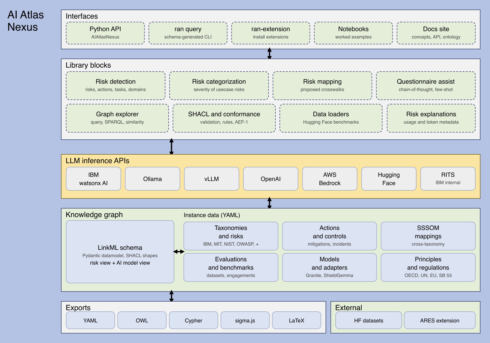

# AI Atlas Nexus


[](https://www.apache.org/licenses/LICENSE-2.0)  [](https://www.python.org/downloads/) </a>

👉 (Jun-2025) The [demo projects repository](https://github.com/IBM/ai-atlas-nexus-demos) showcases implementations of AI Atlas Nexus.

## Overview

AI Atlas Nexus provides tooling to bring together resources related to governance of foundation models. We support a community-driven approach to curating and cataloguing resources such as datasets, benchmarks and mitigations. Our goal is to turn abstract risk definitions into actionable workflows that streamline AI governance processes. By connecting fragmented resources, AI Atlas Nexus seeks to fill a critical gap in AI governance, enabling stakeholders to build more robust, transparent, and accountable systems. AI Atlas Nexus builds on the [IBM AI Risk Atlas](https://www.ibm.com/docs/en/watsonx/saas?topic=ai-risk-atlas) making this educational resource a nexus of governance assets and tooling. A knowledge graph of an AI system is used to provide a unified structure that links and contextualizes the very heterogeneous domain data.

Our intention is to create a starting point for an open AI Systems ontology whose focus is on risk and that the community can extend and enhance. This ontology serves as the foundation that unifies innovation and tooling in the AI risk space. By lowering the barrier to entry for developers, it fosters a governance-first approach to AI solutions, while also inviting the broader community to contribute their own tools and methodologies to expand its impact.

## Features

- 🏗️ **Ontology:** one LinkML schema joins the risk view (taxonomies, risks, actions, controls, incidents) to the AI model view (systems, models, evaluations, adapters)
- 📚 **Taxonomies:** IBM AI Risk Atlas, Granite Guardian, ShieldGemma, MIT AI Risk Repository and mitigations, NIST AI RMF and GenAI Profile, AIR 2024, AILuminate, Credo UCF, AIUC-1, AEF-1, EU GPAI Code of Practice, California SB 53, CSA MAESTRO, Eticas, CSIRO Responsible AI Patterns, OWASP Top 10s (LLM, Agentic Applications, MCP, Agentic Skills), and the OECD, UN, Australian, IBM and RBI principles
- 🔗 **Mappings:** SSSOM crosswalks between taxonomies and between risks and actions, with LLM-proposed new mappings
- 🐍 **Exploration:** a Python API and a schema-generated `ran query` command over risks, actions, controls, incidents, evaluations and datasets
- 🚨 **Detection:** LLM identification of risks, actions, AI tasks and domains from a usecase, with severity and explanations, on WML, Ollama, vLLM, OpenAI, Bedrock, Hugging Face or RITS
- ✅ **Conformance:** SHACL validation and rule inference, and checks of evaluation engagements against standards such as AEF-1
- 📤 **Export:** YAML, OWL, Cypher, sigma.js JSON and LaTeX graphs, queryable with SPARQL through Pyoxigraph
- ✨ **Assistance:** chain-of-thought and few-shot completion of compliance questionnaires
- 🤗 **Data loading:** benchmark and evaluation data from Hugging Face

## Architecture



## Links

- **AI Risk Ontology**
  - [LinkML schema documentation](docs/ontology/index.md)
  - [LinkML instance data for an example knowledge graph](https://github.com/IBM/ai-atlas-nexus/blob/main/src/ai_atlas_nexus/data/knowledge_graph/README.md)
  - [Download a populated graph](https://github.com/IBM/ai-atlas-nexus/blob/main/graph_export/README.md)
  - [Contribute your own taxonomy files and CoT templates](docs/concepts/Contributing_a_taxonomy.md)
  - [Documentation site](https://ibm.github.io/ai-atlas-nexus/) User guide, concepts and API reference
- **Notebooks:**
  - [Quickstart](docs/examples/notebooks/AI_Atlas_Nexus_Quickstart.ipynb) Tour of the library
  - [Risk identification](docs/examples/notebooks/risk_identification.ipynb) Risks for a usecase
  - [AI tasks](docs/examples/notebooks/ai_tasks_identification.ipynb), [domains](docs/examples/notebooks/domain_identification.ipynb) and [capabilities](docs/examples/notebooks/AI_Capabilities_Identification.ipynb) Identification from a usecase
  - [Risk categorization](docs/examples/notebooks/risk_categorization.ipynb) Severity of usecase risks, with prompt templates from https://doi.org/10.48550/arXiv.2407.12454
  - [Auto assist questionnaire](docs/examples/notebooks/autoassist_questionnaire.ipynb) Chain-of-thought and few-shot answers
  - [Crosswalk](docs/examples/notebooks/generate_crosswalk.ipynb), [AIUC-1 crosswalk](docs/examples/notebooks/Crosswalk_with_AIUC-1.ipynb), [preparing](docs/examples/notebooks/Prepare_taxonomy_mappings.ipynb) and [evaluating](docs/examples/notebooks/Evaluate_taxonomy_mappings.ipynb) mappings Relating taxonomies
  - [AEF-1 Minimum Operating Conditions](docs/examples/notebooks/AEF-1_Minimum_Operating_Conditions.ipynb) Conformance of evaluation engagements
  - [Pyoxigraph Explorer](docs/examples/notebooks/Pyoxigraph%20Explorer.ipynb) and [subgraph similarity](docs/examples/notebooks/Subgraph_Extraction_and_Similarity.ipynb) SPARQL and graph comparison
  - [SHACL rule inference](docs/examples/notebooks/shacl_rule_inference.ipynb) and [certification portability](docs/examples/notebooks/shacl_certification_portability.ipynb) Validation and inference
  - [Hugging Face data](docs/examples/notebooks/Loading%20data%20from%20Huggingface.ipynb) and [schema viewer](docs/examples/notebooks/schema_viewer.ipynb)
  - [Risk to ARES Evaluation](docs/examples/notebooks/risk_to_ares_evaluation.ipynb) Robustness evaluation of AI systems derived from usecases
- **Additional Resources:**
  - [Demonstrations](https://github.com/IBM/ai-atlas-nexus-demos) Demo applications.
  - [Extensions](https://github.com/IBM/ai-atlas-nexus-extensions) Extensions and a cookiecutter template for new ones.
  - [IBM AI Risk Atlas](https://www.ibm.com/docs/en/watsonx/saas?topic=ai-risk-atlas)
  - [Usage Governance Advisor: From Intent to AI Governance](https://arxiv.org/abs/2412.01957)

## Installation

This project targets python version ">=3.11, <=3.14.7". You can download specific versions of python here: https://www.python.org/downloads/

**Note:** Replace `INFERENCE_LIB` with `ollama`, `vllm`, `wml` or `bedrock` (see [inference APIs](#install-for-inference-apis)). OpenAI, Hugging Face and RITS need no extra.

To install the current release

```
pip install "ai-atlas-nexus[INFERENCE_LIB]"
```

To install the latest code

```
git clone git@github.com:IBM/ai-atlas-nexus.git
cd ai-atlas-nexus
python -m venv v-ai-atlas-nexus
source v-ai-atlas-nexus/bin/activate
pip install -e ".[INFERENCE_LIB]"
```

### Install for inference APIs

Risk, task and domain identification call a Large Language Model (LLM). AI Atlas Nexus supports these inference APIs:

- [IBM Watsonx AI](https://www.ibm.com/products/watsonx-ai) (Watson Machine Learning)
- [Ollama](https://ollama.com/)
- [vLLM](https://docs.vllm.ai/en/latest/)
- [OpenAI](https://platform.openai.com/) (and OpenAI-compatible endpoints)
- [AWS Bedrock](https://aws.amazon.com/bedrock/)
- [Hugging Face](https://huggingface.co/docs/inference-providers) Inference Providers
- [RITS](https://rits.fmaas.res.ibm.com) (IBM Internal Only)

#### IBM Watsonx AI (WML)

When using the WML platform, you need to:

1. Add following variables to the configuration file `.env` or set them as environment variables. Please follow this [documentation](https://dataplatform.cloud.ibm.com/docs/content/wsj/analyze-data/fm-credentials.html?context=wx&locale=en) on obtaining WML credentials.

```yaml
WML_API_KEY=<WML api key goes here>
WML_API_URL=<WML url key goes here>
WML_PROJECT_ID=<WML project id goes here, Optional>
WML_SPACE_ID=<WML space id goes here, Optional>
```

Either 'WML_PROJECT_ID' or 'WML_SPACE_ID' need to be specified.

2. Install WML dependencies as follows:

```command
pip install -e ".[wml]"
```

**Note**: WML utilizes the function-calling feature for structured outputs. Since the AI Atlas Nexus APIs extensively use structured output, your WML model must support tool calling to be compatible with the AI Atlas Nexus APIs.

#### Ollama

When using the Ollama inference, you need to:

1. Install Ollama dependencies as follows:

```command
pip install -e ".[ollama]"
```

2. Please follow the [quickstart](https://github.com/ollama/ollama/blob/main/README.md#ollama) guide to start Ollama LLM server. Server will start by default at http://localhost:11434

3. When selecting Ollama engine in AI Atlas Nexus, use the server address `localhost:11434` as the `api_url` in the credentials or set the environment variable `OLLAMA_API_URL` with this value.

4. The API will automatically download the OLLAMA model if it is not present. Large models may take a long time to download. Set `auto_download_model` to False to disable this behavior.

#### vLLM

When using the vLLM inference, you need to:

1. For Mac users, follow the instuctions [here](https://docs.vllm.ai/en/stable/getting_started/installation/cpu/index.html?device=apple). Users need to build from the source vLLM to natively run on macOS.

2. For Linux users, install vLLM dependencies as follows:

```command
pip install -e ".[vllm]"
```

Above package is enough to run vLLM in once-off offline mode. When selecting vLLM execution from AI Atlas Nexus, `credentials` should be passed as `None` to use vLLM offline mode.

3. (Optional) To run vLLM on an OpenAI-Compatible vLLM Server, execute the command:

```command
vllm serve ibm-granite/granite-3.1-8b-instruct --max_model_len 4096 --host localhost --port 8000 --api-key <CUSTOM_API_KEY>
```

The CUSTOM_API_KEY can be any string that you choose to use as your API key. Above command will start vLLM server at http://localhost:8000. The server currently hosts one model at a time. Check all supported APIs at `http://localhost:8000/docs`

**Note:** When selecting vLLM engine in AI Atlas Nexus, pass `api_url` as `host:port` and given `api_key` to `credentials` with values from the vllm serve command above.

#### OpenAI

Set these in `.env`, in the environment, or in `credentials`:

```yaml
OPENAI_API_KEY=<OpenAI api key goes here>
OPENAI_API_URL=<Optional, defaults to https://api.openai.com/v1; set it to use an OpenAI-compatible endpoint>
```

The base install is enough.

#### AWS Bedrock

Bedrock runs `openai.*` models through `invoke_model`.

1. Set these in `.env`, in the environment, or in `credentials`:

```yaml
AWS_ACCESS_KEY_ID=<AWS access key id goes here>
AWS_SECRET_ACCESS_KEY=<AWS secret access key goes here>
AWS_DEFAULT_REGION=<Optional, defaults to us-east-1>
```

2. Install Bedrock dependencies as follows:

```command
pip install -e ".[bedrock]"
```

#### Hugging Face

Set these in `.env`, in the environment, or in `credentials`:

```yaml
HF_TOKEN=<Hugging Face access token goes here>
HF_API_URL=<Optional, defaults to https://router.huggingface.co/v1>
HF_ORG=<Optional, organization to bill>
```

The base install is enough.

#### RITS (IBM Internal Only)

When using the RITS platform, you need to:

1. Add configuration to `.env` file as follows:

```yaml
RITS_API_KEY=<RITS api key goes here>
RITS_API_URL=<RITS url key goes here>
```

2. The base install is enough.

## Command line

`ran query` lists the records of the AI Atlas Nexus knowledge graph from a terminal. It has one command for each class of the ontology that holds records, named after the class in lower case, so `RiskControl` is `riskcontrol`. Each command lists the records of its class and of its subclasses. It has one option for each slot of the class, named as in the schema. The commands and options are built from the LinkML schema, so they change when the schema changes. The output is JSON, or YAML with `--format yaml`.

```command
ran query risk --isDefinedByTaxonomy ibm-risk-atlas
ran query risk --id atlas-toxic-output --format yaml
ran query action --hasRelatedRisk credo-risk-036
```

The option of a multivalued slot can be repeated. A record must then hold every value. `--base-dir`, given before the command, adds the records in a directory of YAML files to the packaged ones, as `AIAtlasNexus(base_dir)` does. `ran query --help` lists the commands, and `ran query risk --help` lists the options of one command.

## AI Atlas Nexus Extensions

Install AI Atlas Nexus extension using the below command

```command
ran-extension install <EXTENSION_NAME>
```

Currently, following extensions are available

- [ran-ares-integration](https://github.com/ibm/ai-atlas-nexus-extensions/tree/main/ran-ares-integration): ARES Integration for AI Atlas Nexus to run AI robustness evaluations on AI Systems derived from use cases.

## Compatibility

- Python >=3.11, <=3.14.7.
- View the [releases changelog](https://github.com/IBM/ai-atlas-nexus/releases).

## Referencing the project

If you use AI Atlas Nexus in your projects, please consider citing the following:

```bib
@article{airiskatlas2025,
      title={AI Risk Atlas: Taxonomy and Tooling for Navigating AI Risks and Resources},
      author={Frank Bagehorn and Kristina Brimijoin and Elizabeth M. Daly and Jessica He and Michael Hind and Luis Garces-Erice and Christopher Giblin and Ioana Giurgiu and Jacquelyn Martino and Rahul Nair and David Piorkowski and Ambrish Rawat and John Richards and Sean Rooney and Dhaval Salwala and Seshu Tirupathi and Peter Urbanetz and Kush R. Varshney and Inge Vejsbjerg and Mira L. Wolf-Bauwens},
      year={2025},
      eprint={2503.05780},
      archivePrefix={arXiv},
      primaryClass={cs.CY},
      url={https://arxiv.org/abs/2503.05780}
}
```

## License

AI Atlas Nexus is provided under Apache 2.0 license.

## Contributing

- Get started by checking our [contribution guidelines](CONTRIBUTING.md).
- Read the [documentation site](https://ibm.github.io/ai-atlas-nexus/) for more technical and design details.
- If you have any questions, just ask!
- [Contribute your own taxonomy files and CoT templates](docs/concepts/Contributing_a_taxonomy.md)

Tip: Use the makefile provided to regenerate artifacts provided in the repository by running `make` in this repository.

## Find out more

- Try out a quick demo at the [HF spaces demo site](https://huggingface.co/spaces/ibm/risk-atlas-nexus)
- Read the publication [AI Risk Atlas: Taxonomy and Tooling for Navigating AI Risks and Resources](https://arxiv.org/pdf/2503.05780)
- Explore [IBM's AI Risk Atlas](https://www.ibm.com/docs/en/watsonx/saas?topic=ai-risk-atlas) on the IBM documentation site
- Read the the IBM AI Ethics Board publication [Foundation models: Opportunities, risks and mitigations](https://www.ibm.com/downloads/documents/us-en/10a99803d8afd656) which goes into more detail about the risk taxonomy, and describes the point of view of IBM on the ethics of foundation models.
- ['Usage Governance Advisor: From Intent to AI Governance'](https://arxiv.org/abs/2412.01957) presents a system for semi-structured governance information, identifying and prioritising risks according to the intended use case, recommending appropriate benchmarks and risk assessments and proposing mitigation strategies and actions.

## IBM ❤️ Open Source AI

AI Atlas Nexus has been brought to you by IBM.
